class: center, middle

### Llenguatges de Programació

## Introducció a la compilació

<br><br>

**Jordi Petit i Gerard Escudero**


---
class: left, middle, inverse

## Contingut

- .cyan[Introducció]

- Visió general

- Anàlisi lèxica

- Anàlisi sintàctica

- Arbres de sintaxi abstracta

- Anàlisi semàntica

- Interpretació

---

# Objectius


- Conèixer l'estructural general d'un compilador, les seves principals
etapes, i la seva organització.

- Conèixer l'existència d'eines per ajudar a crear compiladors (usarem [ANTLR](https://www.antlr.org/)).

- A la pràctica, ens limitem a crear petits processadors de llenguatges:
    1. Definició del vocabulari,
    2. Definició de la gramàtica,
    3. Generació de l'arbre de sintaxi abstracta,
    4. Interpretació a través del recorregut de l'arbre.

<br>

- El curs de Compiladors aprofundeix molts més els continguts.
- El curs de Teoria de la Computació n'ofereix els fonaments teòrics.

---

# Crèdits

Gran part del material d'aquestes diapositives sobre compilació s'ha extret de
les que va elaborar el professor **Stephen A. Edwards** (Universitat
de Columbia) per l'assignatura COMS W4115 (Programming
Languages and Translators) i que el professor **Jordi Cortadella**
(UPC) va adaptar per l'assignatura de Compiladors. També s'ha extret material
de les transparències del professor **Fernando Orejas** (UPC).

---

# Compiladors

.center[
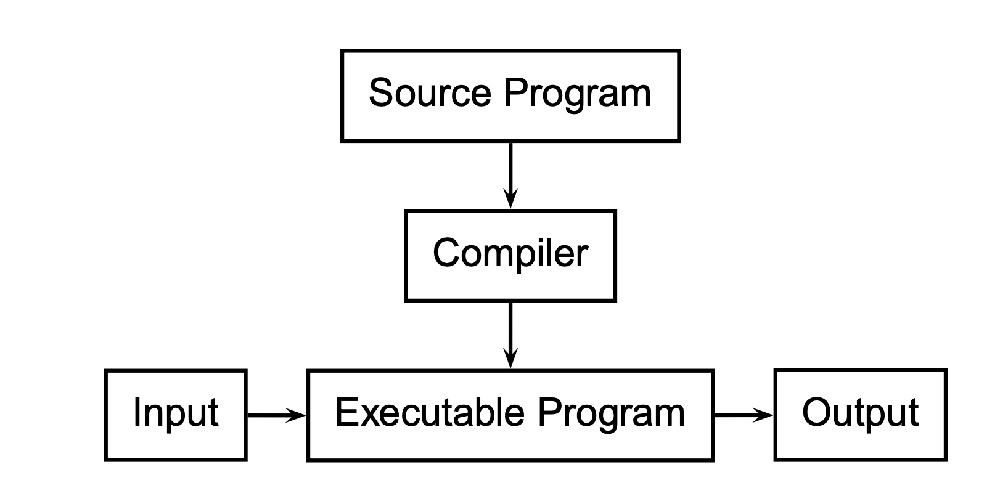
]

Un **compilador** és un programa que tradueix programes escrits  en un LP d'alt
nivell a codi màquina (o, en general, a codi de baix nivell).

Exemples: GCC, CLANG, go, ghc, ...

---

# Compiladors

Compilació en C

```c
int func(int a, int b) {
    a = a + b;
    return a;
}
```

`gcc -S prova.c`

```
_func:
    pushq   %rbp
    movq    %rsp, %rbp
    movl    %edi, -4(%rbp)
    movl    %esi, -8(%rbp)
    movl    -4(%rbp), %eax
    addl    -8(%rbp), %eax
    movl    %eax, -4(%rbp)
    movl    -4(%rbp), %eax
    popq    %rbp
    retq
```


---

# Intèrprets

.center[
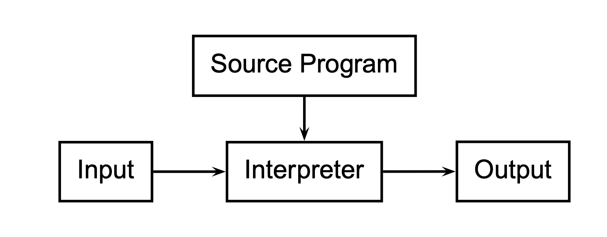
]

Un **intèrpret** és un programa que executa directament instruccions escrites
en un LP.

Exemples: Python, PHP, Perl, ghci, BASIC, Logo...

---

# Intèrprets

Sessió amb l'intèrpret de BASIC al Commodore 64 (emulat al Mac 🤣!)

.center[
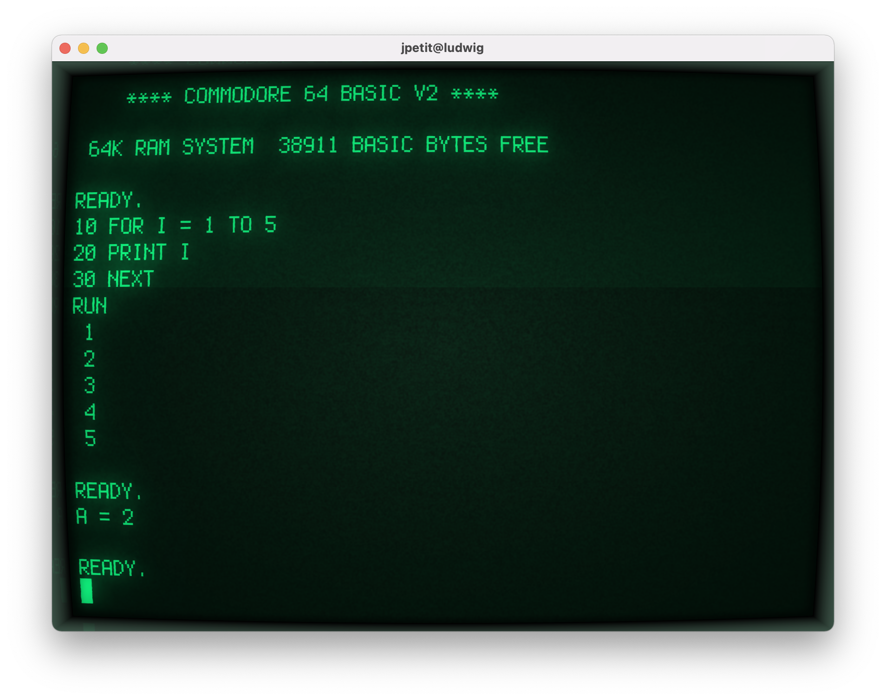
]


---

# Intèrprets de bytecode

.center[
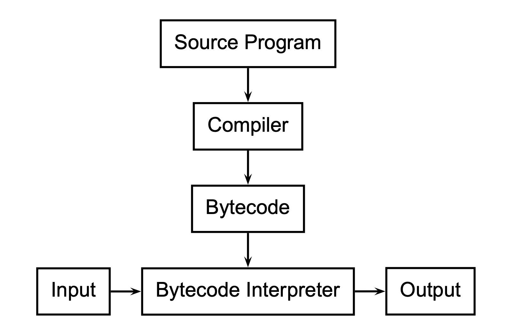
]

Variant entre els compiladors i els intèrprets.

- El **bytecode** és un codi intermedi més abstracte que el codi màquina.
- Augmenta la portabilitat i seguretat i facilita la interpretació.
- Una **màquina virtual** interpreta programes en bytecode.

Exemples: Java, Python, ...


---

# Intèrprets de bytecode

**CPython per a Python**

```python
>>> import dis  # desensamblador
>>> dis.dis("a = a + b")
  1   0 LOAD_NAME     0 (a)
      2 LOAD_NAME     1 (b)
      4 BINARY_ADD
      6 STORE_NAME    0 (a)
      8 LOAD_CONST    0 (None)
    10 RETURN_VALUE
```

.small[
La VM de CPython usa tres tipus de piles:

- **Call stack**: Guarda l'estructura principal de l'execució d'un programa en Python.

    Hi ha *frame* per a cada crida oberta a una funció.
    Cada crida a una funció empila un nou *frame* i
    cada sortida de funció el desempila. És on es desen les variables locals.

- A cada *frame*, hi ha un **evaluation stack**: És on es fa l'avaluació de les expressions,
ficant paràmetres i extraient resultats.

- A cada *frame*, també hi ha un **block stack**:
És on es realitza l'execució de les instruccions
(condicionals, bucles, `try/except`s, `with`s, `continue`s, `break`s, ...)
]

---

# Intèrprets de bytecode

**JVM per a Java**

```java
public static void func(int a, int b) {
    a = a + b;
}
```

`javap -v prova.class`

```
public static void func(int, int);
    descriptor: (II)V
    flags: (0x0009) ACC_PUBLIC, ACC_STATIC
    Code:
      stack=2, locals=2, args_size=2
         0: iload_0
         1: iload_1
         2: iadd
         3: istore_0
         4: return
```

---

# Compiladors *just-in-time*

.center[
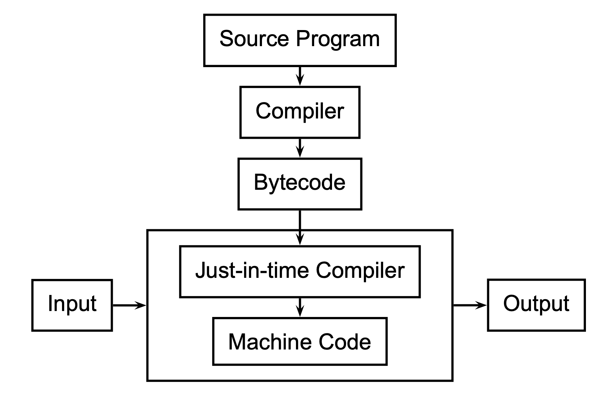
]


La compilació **just-in-time** (JIT)
compila fragments del programa durant la seva execució.

Un analitzador inspecciona el codi executat per veure quan val la pena
compilar-lo.

Exemples: Julia, V8 per Javascript, JVM per Java, ...

---

# Compiladors *just-in-time*

[Numba](https://numba.pydata.org/) tradueix funcions en Python
a codi màquina i optimitzat usant LLVM en temps d'execució.

```python
import numba
import random

@numba.jit(nopython=True)
def monte_carlo_pi(nsamples):
    acc = 0
    for i in range(nsamples):
        x = random.random()
        y = random.random()
        if x*x + y*y < 1.0:
            acc += 1
    return 4.0 * acc / nsamples
```

---
class: left, middle, inverse

## Contingut

- .brown[Introducció]

- .cyan[Visió general]

  - .cyan[Processadors de llenguatges]

  - Sintaxi

  - Semàntica

  - Flux de compilació

  - Eines

- Anàlisi lèxica

- Anàlisi sintàctica

- Arbres de sintaxi abstracta

- Anàlisi semàntica

- Interpretació

---

# Preprocessadors

Un **preprocessador** prepara el codi font d'un programa abans que el compilador
el vegi.

- Expansió de macros
- Inclusió de fitxers
- Compilació condicional
- Extensions de llenguatge

Exemples: cpp, m4, ...

---

# Preprocessadors

El preprocessador de C


```c
#include <stdio.h>
#define min(x, y) ((x)<(y))?(x):(y)
#ifdef DEFINE_BAZ
int baz();
#endif
void foo() {
    int a = 1;
    int b = 2;
    int c;
    c = min(a,b);
}
```

`gcc -E programa.c`

```c
extern int printf(char*, ...);
⠇ moltes més línies de stdio.h
void foo() {
    int a = 1;
    int b = 2;
    int c;
    c = ((a)<(b))?(a):(b);
}
```

---

# Ecosistema

Els processadors de llenguatges viuen en un ecosistema gran i complex:
preprocessadors, compiladors, enllaçadors, gestors de llibreries,
ABIs (application binary interfaces),
formats d'executables, ...

<br>

.center[
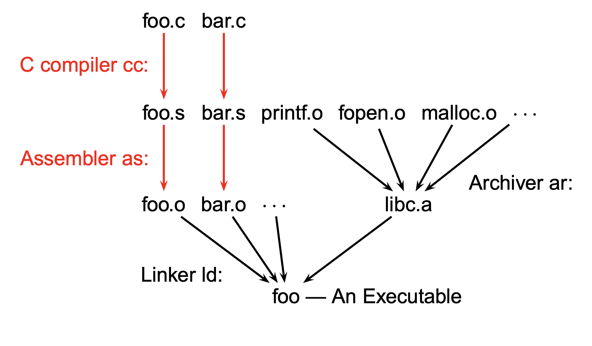
]

---
class: left, middle, inverse

## Contingut

- .brown[Introducció]

- .cyan[Visió general]

  - .brown[Processadors de llenguatges]

  - .cyan[Sintaxi]

  - Semàntica

  - Flux de compilació

  - Eines

- Anàlisi lèxica

- Anàlisi sintàctica

- Arbres de sintaxi abstracta

- Anàlisi semàntica

- Interpretació

---

# Sintaxi

La **sintaxi** d'un llenguatge de programació és el conjunt de regles que
defineixen les combinacions de símbols que es consideren construccions
correctament estructurades.

```
Jove xef, porti whisky amb quinze glaçons d'hidrogen, coi!
```

> ➡️  frase sintàcticament correcta en català, però no és un programa en Java.


```java
class Foo {
    public int j;
    public int foo(int k) {
        return j + k;
    }
}
```

> ➡️ programa sintàcticament correcte en Java, però no és un programa en C.

---

# Sintaxi

Sovint s'especifica la sintaxi utilitzant una **gramàtica lliure de context**
(*context-free grammar*).

Els elements més bàsics ("paraules") s'especifiquen a
través d'**expressions regulars**.

<br>

Exemple per expressions algebraiques:

```
expr → NUM
     | '(' expr ')'
     | expr '+' expr
     | expr '-' expr
     | expr '*' expr
     | expr '/' expr

NUM  → [0-9]+ ( '.' [0-9]+ )
```

---
class: left, middle, inverse

## Contingut

- .brown[Introducció]

- .cyan[Visió general]

  - .brown[Processadors de llenguatges]

  - .brown[Sintaxi]

  - .cyan[Semàntica]

  - Flux de compilació

  - Eines

- Anàlisi lèxica

- Anàlisi sintàctica

- Arbres de sintaxi abstracta

- Anàlisi semàntica

- Interpretació

---

# Semàntica

La **semàntica** d'un LP descriu què significa un programa ben construït.


```python
def fib(n):
    a, b = 0, 1
    for i in range(n):
        a, b = b, a + b
    return a
```

> ➡️  La semàntica d'aquesta funció en Python és el càlcul de l'`n`-èsim
nombre de Fibonacci.


---

# Semàntica

A vegades, les construccions sintàcticament correctes poden ser semànticament incorrectes.

```
L'arc de Sant Martí va saltar sobre el planeta pelut.
```

> ➡️  sintàcticament correcta en català, però sense sentit.

<br>

```java
class Foo {
    int bar(int x) { return Foo; }
}
```

> ➡️  sintàcticament correcte en Java, però sense sentit.


---

# Semàntica

A vegades, les construccions sintàcticament correctes poden ser ambigües.

```
Han posat un banc a la plaça.
```

> ➡️  sintàcticament correcta en català, però ambigua


<br>

```java
class Bar {
    public float foo() { return 0; }
    public int foo()   { return 0; }
}
```

> ➡️  sintàcticament correcte en Java, però ambigu.


---

# Semàntica

Hi ha bàsicament dues maneres d'especificar formalment la semàntica:

- **Semàntica operacional:** defineix una màquina virtual i
com l'execució del programa canvia l'estat de la màquina.

- **Semàntica denotacional:** mostra com construir una
funció que representa el comportament del programa (és a dir,
una transformació d'entrades a sortides) a partir de les construccions del LP.

La majoria de definicions de semàntica per a LPs utilitzen una semàntica
operacional descrita informalment en llenguatge natural.

.center[
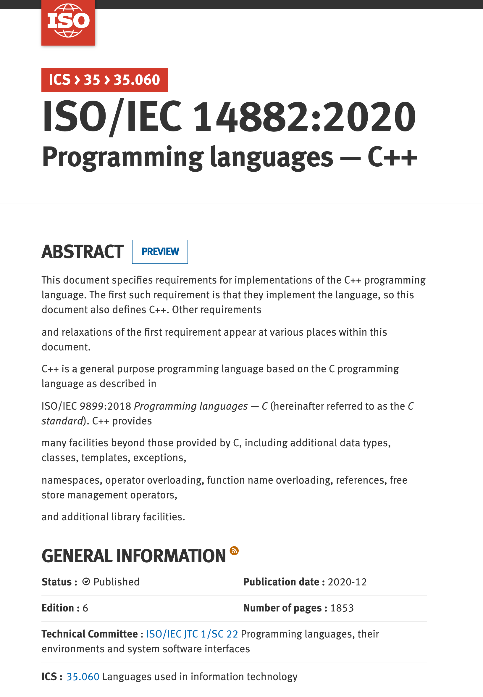
&nbsp; &nbsp; &nbsp; &nbsp; &nbsp; &nbsp;
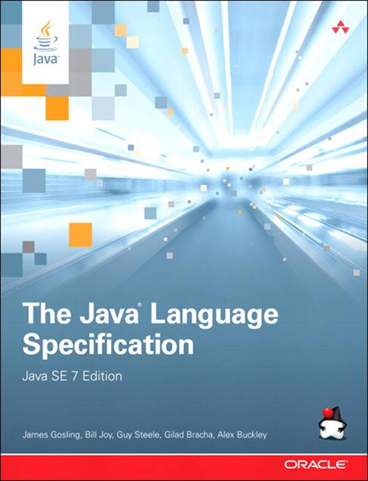
]

---
class: left, middle, inverse

## Contingut

- .brown[Introducció]

- .cyan[Visió general]

  - .brown[Processadors de llenguatges]

  - .brown[Sintaxi]

  - .brown[Semàntica]

  - .cyan[Flux de compilació]

  - Eines

- Anàlisi lèxica

- Anàlisi sintàctica

- Arbres de sintaxi abstracta

- Anàlisi semàntica

- Interpretació

---

# Etapes

- Front end
    - preprocessador
    - analitzador lèxic (escàner)
    - analitzador sintàctic (parser)
    - analitzador semàntic
- Middle end
    - generador de codi intermedi
    - optimitzador de codi intermedi
- Back end
    - generador de codi específic
    - optimitzador de codi específic

---

# Entrada

```c
int gcd(int a, int b) {
    while (a != b) {
        if (a > b) a -= b; else b -= a;
    }
    return a;
}
```

El compilador veu una seqüència de caràcters:

```
i n t ␣ g c d ( i n t ␣ a , ␣ i n t ␣ b ) ␣ { ⏎ ␣ ␣ w h i l e ␣
( a ␣ ! = ␣ b ) ␣ { ⏎ ␣ ␣ ␣ ␣ i f ␣ ( a ␣ > ␣ b ) ␣ a ␣ - = ␣ b
; ␣ e l s e ␣ b ␣ - = ␣ a ; ⏎ ␣ ␣ } ⏎ ␣ ␣ r e t u r n ␣ a ; ⏎ } ⏎
```

---

# Analitzador lèxic

```c
int gcd(int a, int b) {
    while (a != b) {
        if (a > b) a -= b; else b -= a;
    }
    return a;
}
```

L'**analitzador lèxic** (**escàner**) agrupa els caràcters en "paraules" (tokens) i elimina
blancs i comentaris.

.center[
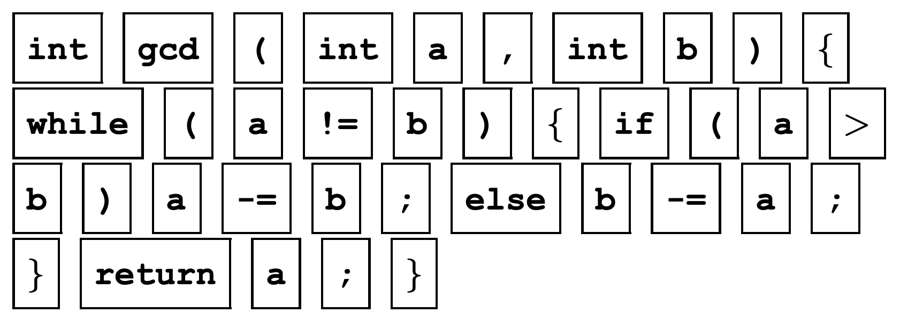
]

---

# Analitzador sintàctic

```c
int gcd(int a, int b) {
    while (a != b) {
        if (a > b) a -= b; else b -= a;
    }
    return a;
}
```

L'**analitzador sintàctic** (**parser**)
construeix un **arbre de sintaxi abstracta**
(AST) a partir de la seqüència
de tokens i les regles sintàctiques.

.center[
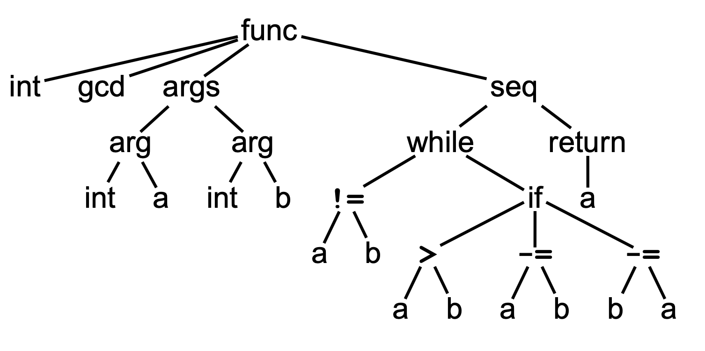
]

Les paraules clau, els separadors, parèntesis i blocs s'eliminen.

---

# Analitzador semàntic

```c
int gcd(int a, int b) {
    while (a != b) {
        if (a > b) a -= b; else b -= a;
    }
    return a;
}
```

.cols5050[
.col1[
L'**analitzador semàntic**
recorre l'AST i:

- crea la **taula de símbols**,
- assigna memòria a les variables,
- comprova errors de tipus,
- resol ambigüitats.

El resultat és la taula de símbols i un AST decorat.
]
.col2[
.center[
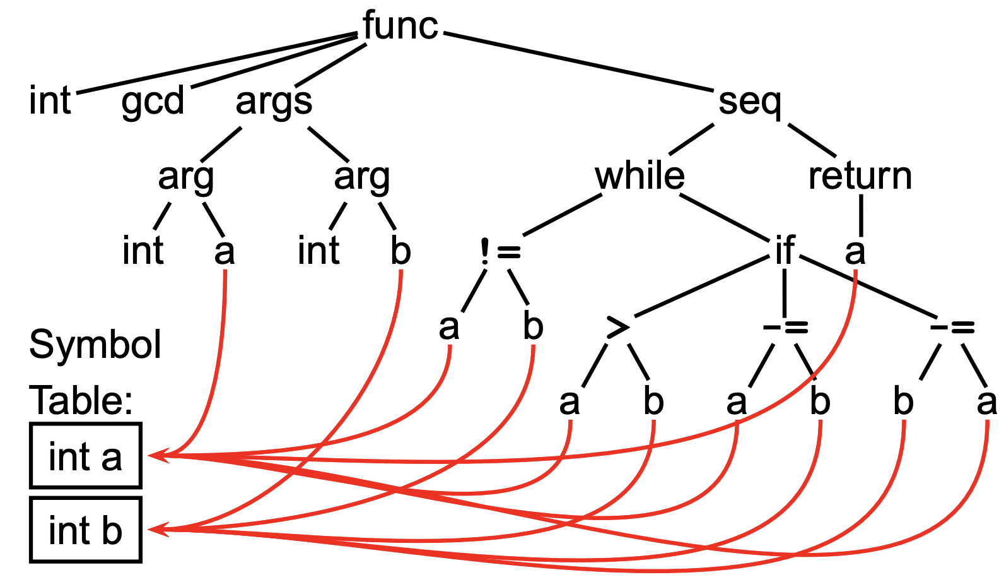
]
]]

---

# Generador de codi intermedi

```c
int gcd(int a, int b) {
    while (a != b) {
        if (a > b) a -= b; else b -= a;
    }
    return a;
}
```

El **generador de codi** tradueix el programa a **codi de tres adreces**
(ensamblador idealitzat amb infinitat de registres).

```bash
L0:     sne $1, a, b            # signed not equal
        seq $0, $1, 0           # signed equal
        btrue $0, L1            # while a != b
        sl $3, b, a             # signed less
        seq $2, $3, 0
        btrue $2, L4            #    if a < b
        sub a, a, b             #       a -= b
        jmp L5
L4:     sub b, b, a             #       b -= a
L5:     jmp L0
L1:     ret a                   # return a
```

---

# Optimitzador de codi intermedi

.small[
```bash
L0:     sne $1, a, b            # signed not equal
        seq $0, $1, 0           # signed equal
        btrue $0, L1            # while a != b
        sl $3, b, a             # signed less
        seq $2, $3, 0
        btrue $2, L4            #    if a < b
        sub a, a, b             #       a -= b
        jmp L5
L4:     sub b, b, a             #       b -= a
L5:     jmp L0
L1:     ret a                   # return a
```

El **back end** tradueix i optimitza el codi de tres adreces a l'arquitectura desitjada:


```bash
gcd:    pushl %ebp              # Save FP                      [asm 80386]
        movl %esp,%ebp
        movl 8(%ebp),%eax       # Load a from stack
        movl 12(%ebp),%edx      # Load b from stack
.L8:    cmpl %edx,%eax
        je .L3                  # while a != b
        jle .L5                 #    if (a < b)
        subl %edx,%eax          #       a -= b
        jmp .L8
.L5:    subl %eax,%edx          #       b -= a
        jmp .L8
.L3:    leave                   # Restore SP, BP
        ret                     # return a
```
]

---

# Sumari

.center[
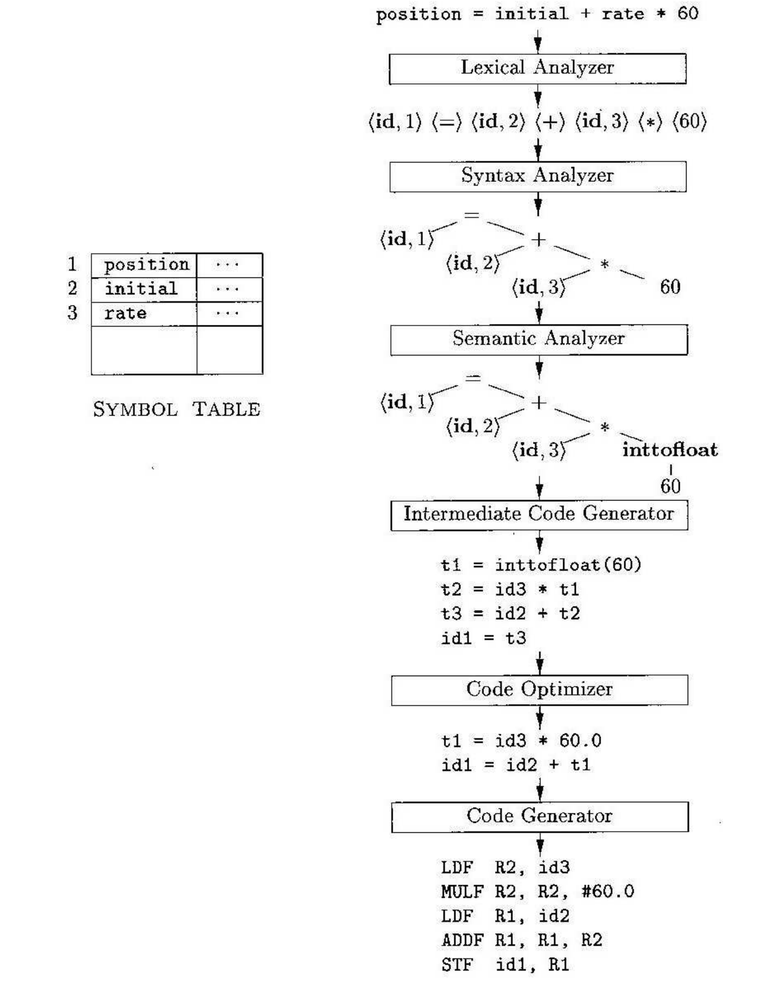
]

---
class: left, middle, inverse

## Contingut

- .brown[Introducció]

- .cyan[Visió general]

  - .brown[Processadors de llenguatges]

  - .brown[Sintaxi]

  - .brown[Semàntica]

  - .brown[Flux de compilació]

  - .cyan[Eines]

- Anàlisi lèxica

- Anàlisi sintàctica

- Arbres de sintaxi abstracta

- Anàlisi semàntica

- Interpretació

---

# Eines

Per construir un compilador no es parteix de zero.

Hi ha moltes eines que donen suport.

Exemples:

 - ANTLR, donades les especificacions lèxiques i sintàctiques del
LP, construeix automàticament l’escàner, l’analitzador i l'AST.

- LLVM ofereix una col·lecció d'eines modulars reutilitzables pels
backends dels compiladors.

---
class: left, middle, inverse

## Contingut

- .brown[Introducció]

- .brown[Visió general]

- .cyan[Anàlisi lèxica]

- Anàlisi sintàctica

- Arbres de sintaxi abstracta

- Anàlisi semàntica

- Interpretació

---

# Anàlisi lèxica


L'**analitzador lèxic** (o **escàner**)
converteix una seqüència de caràcters en una seqüència de **tokens**:

- identificadors,
- literals (nombres, textos, caràcters)
- paraules clau,
- operadors,
- puntuació...

.center[
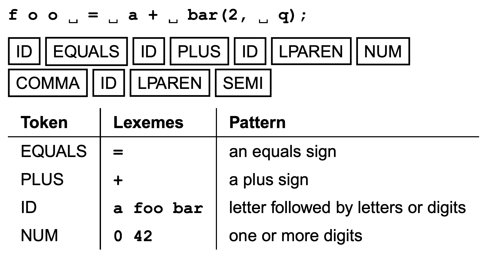
]

---

# Objectius


- Simplificar la feina de l'analitzador sintàctic.

    > El parser no té en compte els noms dels identificadors,
    només li preocupen els tokens (`supercalifragilisticexpialidocious` → `ID`).

- Descartar detalls irrellevants: blancs, comentaris, ...

- Els escàners són molt més ràpids que els parsers.

---

# Descripció de tokens


Per especificar els tokens s'utilitzen conceptes de la teoria de llenguatges:


**Alfabet:** un conjunt finit de símbols.

> Exemples: {0, 1}, {`A`, `B`, ..., `Z`}, ASCII, Unicode, ...


**Paraula:** una seqüència finita de símbols de l'alfabet.

> Exemples: ε (la paraula buida), `foo`, `αβγ`.


**Llenguatge:** Un conjunt de paraules sobre un alfabet.

> Exemples: ∅ (el llenguatge buit), { 1, 11, 111, 1111 },
> tots els mots anglesos, tots els identificadors (textos que comencen
> amb una lletra seguida per lletres o dígits).

---

# Operacions sobre llenguatges

> Exemple:  *L* = { ε, wo }, *M* = { man, men }

**Concatenació:** Una paraules d'un llenguatge seguida d'una paraula de l'altre llenguatge.

> *L M* = { man, men, woman, women }

**Unió:** Totes les paraules de cada llenguatge.

> *L* ∪ *M* = {ε, wo, man, men }

**Clausura de Kleene:** Zero o més concatenacions.

> *M﹡* = {ε} ∪ *M* ∪ *MM* ∪ *MMM* ∪ ... = {ε, man, men, manman, manmen, menman, menmen,
> manmanman, manmanmen, manmenman, ...}


---

# Expressions regulars

Les **expressions regulars** descriuen
llenguatges a partir de tokens sobre un alfabet *Σ*.

1. ε és una expressió regular que denota {ε}.

2. Si *a* ∈ *Σ*, *a* és una expressió regular que denota {*a*}.


3. Si *r* i *s* denoten els llenguatges *L(r)* i *L(s)*,

    - (*r*)|(*s*) denota *L(r)* ∪ *L(s)*

    - (*r*)(*s*) denota {*tu* : *t* ∈ *L(r)*, *u* ∈ *L(s)*}

    - (*r﹡*) denota la clausura transitiva de *L(r)*

---

# Expressions regulars

Exemples:

.center[
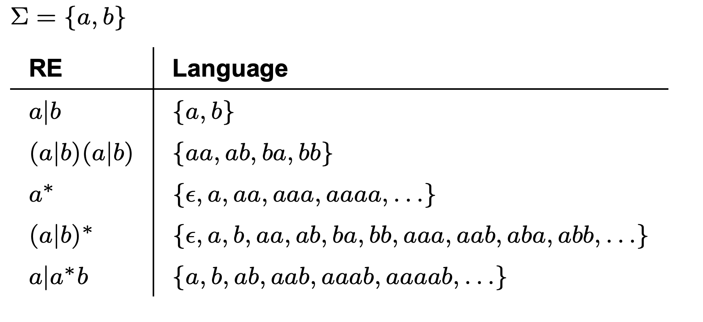
]

---

# Generadors d'escàners


Les expressions regulars s'usen en eines per crear compiladors:

- lex, ANTLR, ...

I també,

- en comandes del SO per tractar fitxers (`grep`, `sed`, ...)

- en llibreries d'LPs per tractar textos (`re` en Python, directament en Javascript, ...)

---

# Generadors d'escàners

A partir de la definició lèxica,
l'escàner és un autòmat determinista que
produeix com a sortida els tokens reconeguts.

Construcció:

<br>

.center[

.boxed[Regles amb expressions regulars]

⬇

.boxed[Autòmats finits no deterministes]

⬇

.boxed[Autòmat finit determinista]

⬇

.boxed[Taules]
]

---

# Analitzador lèxic d'ANTLR

.cols5050[
.col1[
```antlr
DIGIT   : '0'..'9' ;
LETTER  : [a-zA-Z] ;

NUMBER  : (DIGIT)+ ;
IDENT   : LETTER (LETTER | DIGIT)* ;

WS      : [ \t\n]+ -> skip ;
```

.small[
[Referència](https://github.com/antlr/antlr4/blob/master/doc/lexer-rules.md)
]
]
.col2[
.small[
- els noms dels tokens han de ser en majúscules

- textos entre cometes representen aquell text

- ajuntar indica concatenació

- `|` indica unió

- `*` indica zero o més

- `+` indica un o més

- `?` indica un o cap

- `..` indica rangs

- es poden agrupar elements amb parèntesis

- l'`skip` no reporta el token
]
]
]

---

# grep

.cols5050[
.col1[
La comanda `grep` (*global regular expression print*)
permet cercar patrons en texts.

```bash
grep 'jpetit' /etc/passwd
```

<br><br><br><br>
.small[.right[
Imatge: Dave Child, [cheatography.com](https://cheatography.com/davechild/cheat-sheets/regular-expressions/)
]]
]
.col2[
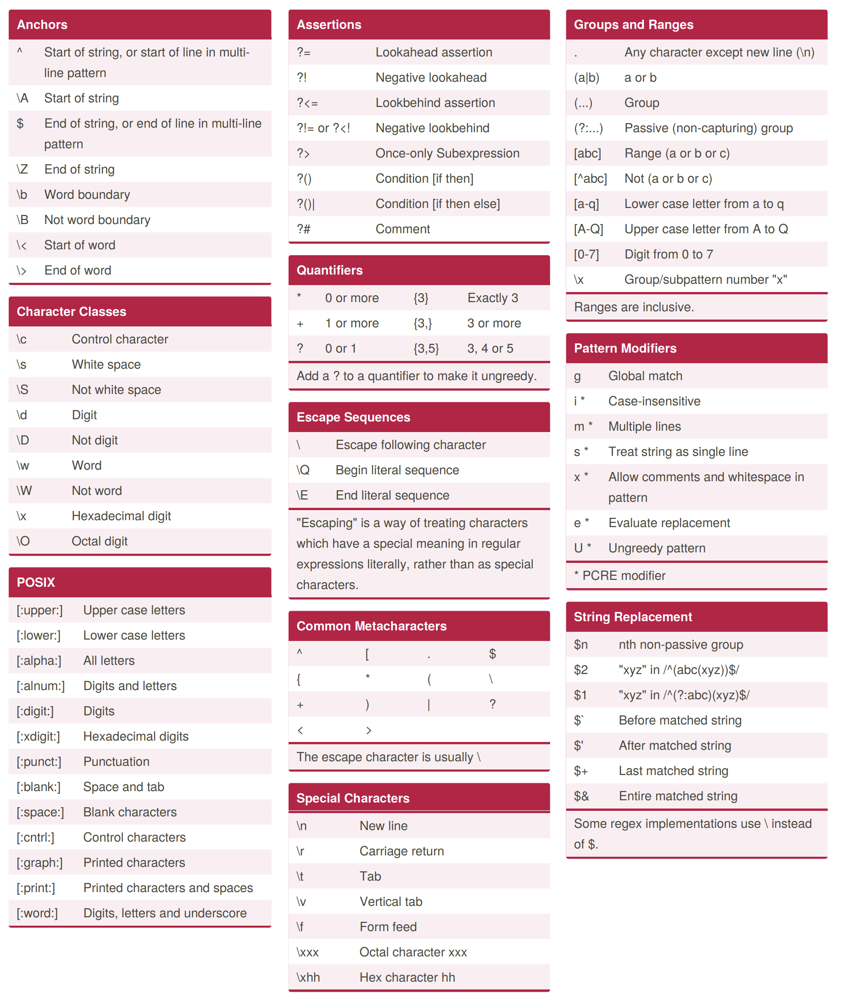
]
]

---

# re

El mòdul `re`
de Python proporciona
operacions sobre expressions regulars.

```python
>>> import re

>>> p = re.compile('[a-z]+')
>>> p.match("7654386732().")
None
>>> m = p.match('unicorn')
>>> m.group()
'unicorn'
>>> m.start(), m.end()
(0, 7)
>>> m.span()
(0, 7)

>>> re.search('casa', 'vaig a casa a dormir')
<re.Match object; span=(7, 11), match='casa'>

>>> re.sub('[0-9]+', 'molts', 'val 350 euros')
'val molts euros'
```

.right[
.small[
[Tutorial](https://docs.python.org/3/howto/regex.html)
]
]

---

# Testing d'expressions regulars


Some people, when confronted with a problem, think "*I'll use regular
expressions*". Now they have two problems.

.right[⸺ Jamie Zawinski, 1997]


.center[
<a href='https://regex101.com'>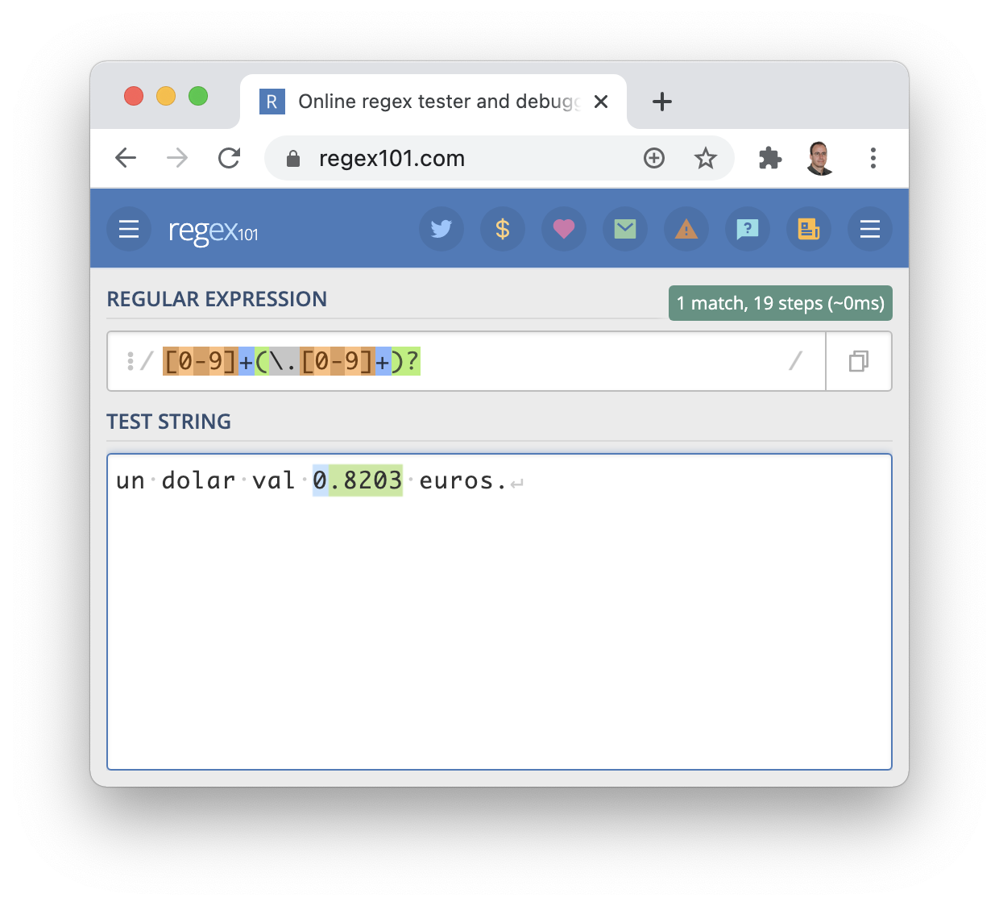</a>
]

---

# Exercicis


Definiu expressions regulars pels llenguatges següents:

1. Identificadors de C++: poden contenir lletres, dígits i subratllats
però no poden començar per un dígit.

1. Nombres en coma flotant.   Si s'utilitza un punt decimal, un dígit decimal és obligatori.

    > Exemples: `3.1416`, `-3e4`, `+1.0e-5`, `.567e+8`, ...

1. Totes les paraules amb alfabet {`a`, `b`, `c`}
en les quals la primera aparició de `b` sempre és precedida per,
com a mínim, una aparició de `a`.

1. Totes les paraules amb minúscules que contenen les cinc vocals en ordre
(cada vocal només pot aparèixer un sol cop).

    > Example: `zfaehipojksuj`

1. Totes les paraules amb minúscules en les quals les lletres es troben en
ordre lexicogràfic ascendent.

    > Examples: `afhmnqsyz`, `abcdz`, `dgky`, ... Contraexemple: `bdeaz`.

---
class: left, middle, inverse

## Contingut

- .brown[Introducció]

- .brown[Visió general]

- .brown[Anàlisi lèxica]

- .cyan[Anàlisi sintàctica]

  - Desambiguació de gramàtiques

  - Generadors d'analitzadors

- Arbres de sintaxi abstracta

- Anàlisi semàntica

- Interpretació

---

# Anàlisi sintàctica


L'objectiu de l'**analitzador sintàctic** (o **parser**) és convertir una seqüència de tokens
en un arbre de sintaxi abstracta que capturi la jerarquia de les construccions.


.cols5050[
.col1[
```c
int gcd(int a, int b) {
    while (a != b) {
        if (a > b) a -= b; else b -= a;
    }
    return a;
}
```
]
.col2[
.center[

]
]]

→ Es descarta informació no rellevant com les paraules clau,
els separadors, els parèntesis i els blocs.

→ Es facilita la feina dels propers estadis.

---

# Gramàtiques

La majoria dels LPs es descriuen a través de **gramàtiques incontextuals**,
usant notació **BNF** (Backus–Naur form).

```
pgma → expr ; pgma
     | ε

expr → expr + expr
     | expr - expr
     | expr * expr
     | expr / expr
     | ( expr )
     | NUM
```


Les gramàtiques incontextuals permeten descriure llenguatges més amplis
que els llenguatges regulars perquè són "recursives".

> **Exemple:** Llenguatge dels mots capicues
<br> &nbsp; &nbsp; &nbsp; &nbsp; ✅ gramàtica incontextual
<br> &nbsp; &nbsp; &nbsp; &nbsp; ❌ expressió regular

→ La recursivitat permet definir jerarquies i niuar elements (parèntesis o blocs).


---

# Gramàtiques

Exemple: [Gramàtica de C](https://cs.wmich.edu/~gupta/teaching/cs4850/sumII06/The%20syntax%20of%20C%20in%20Backus-Naur%20form.htm) 📜

<pre style='margin-left: 0em; padding: 10px; height: 32em; overflow-y: auto; background-color: #272822; border-radius: 5px; color: white; font-size: 14px;'>
translation-unit     : {external-declaration}*

external-declaration     : function-definition
                         | declaration

function-definition     : {declaration-specifier}* declarator {declaration}* compound-statement

declaration-specifier     : storage-class-specifier
                          | type-specifier
                          | type-qualifier

storage-class-specifier     : auto
                            | register
                            | static
                            | extern
                            | typedef

type-specifier     : void
                   | char
                   | short
                   | int
                   | long
                   | float
                   | double
                   | signed
                   | unsigned
                   | struct-or-union-specifier
                   | enum-specifier
                   | typedef-name

struct-or-union-specifier     : struct-or-union identifier { {struct-declaration}+ }
                              | struct-or-union { {struct-declaration}+ }
                              | struct-or-union identifier

struct-or-union     : struct
                    | union

struct-declaration     : {specifier-qualifier}* struct-declarator-list

specifier-qualifier     : type-specifier
                        | type-qualifier

struct-declarator-list     : struct-declarator
                           | struct-declarator-list , struct-declarator

struct-declarator     : declarator
                      | declarator : constant-expression
                      | : constant-expression

declarator     : {pointer}? direct-declarator

pointer     : * {type-qualifier}* {pointer}?

type-qualifier     : const
                   | volatile

direct-declarator     : identifier
                      | ( declarator )
                      | direct-declarator [ {constant-expression}? ]
                      | direct-declarator ( parameter-type-list )
                      | direct-declarator ( {identifier}* )

constant-expression     : conditional-expression

conditional-expression     : logical-or-expression
                           | logical-or-expression ? expression : conditional-expression

logical-or-expression     : logical-and-expression
                          | logical-or-expression || logical-and-expression

logical-and-expression     : inclusive-or-expression
                           | logical-and-expression && inclusive-or-expression

inclusive-or-expression     : exclusive-or-expression
                            | inclusive-or-expression | exclusive-or-expression

exclusive-or-expression     : and-expression
                            | exclusive-or-expression ^ and-expression

and-expression     : equality-expression
                   | and-expression & equality-expression

equality-expression     : relational-expression
                        | equality-expression == relational-expression
                        | equality-expression != relational-expression

relational-expression     : shift-expression
                          | relational-expression < shift-expression
                          | relational-expression > shift-expression
                          | relational-expression <= shift-expression
                          | relational-expression >= shift-expression

shift-expression     : additive-expression
                     | shift-expression << additive-expression
                     | shift-expression >> additive-expression

additive-expression     : multiplicative-expression
                        | additive-expression + multiplicative-expression
                        | additive-expression - multiplicative-expression

multiplicative-expression     : cast-expression
                              | multiplicative-expression * cast-expression
                              | multiplicative-expression / cast-expression
                              | multiplicative-expression % cast-expression

cast-expression     : unary-expression
                    | ( type-name ) cast-expression

unary-expression     : postfix-expression
                     | ++ unary-expression
                     | -- unary-expression
                     | unary-operator cast-expression
                     | sizeof unary-expression
                     | sizeof type-name

postfix-expression     : primary-expression
                       | postfix-expression [ expression ]
                       | postfix-expression ( {assignment-expression}* )
                       | postfix-expression . identifier
                       | postfix-expression - identifier
                       | postfix-expression ++
                       | postfix-expression --

primary-expression     : identifier
                       | constant
                       | string
                       | ( expression )

constant     : integer-constant
             | character-constant
             | floating-constant
             | enumeration-constant

expression     : assignment-expression
               | expression , assignment-expression

assignment-expression     : conditional-expression
                          | unary-expression assignment-operator assignment-expression

assignment-operator     : =
                        | *=
                        | /=
                        | %=
                        | +=
                        | -=
                        | <<=
                        | >>=
                        | &=
                        | ^=
                        | |=

unary-operator     : &
                   | *
                   | +
                   | -
                   | ~
                   | !

type-name     : {specifier-qualifier}+ {abstract-declarator}?

parameter-type-list     : parameter-list
                        | parameter-list , ...

parameter-list     : parameter-declaration
                   | parameter-list , parameter-declaration

parameter-declaration     : {declaration-specifier}+ declarator
                          | {declaration-specifier}+ abstract-declarator
                          | {declaration-specifier}+

abstract-declarator     : pointer
                        | pointer direct-abstract-declarator
                        | direct-abstract-declarator

direct-abstract-declarator     :  ( abstract-declarator )
                               | {direct-abstract-declarator}? [ {constant-expression}? ]
                               | {direct-abstract-declarator}? ( {parameter-type-list}? )

enum-specifier     : enum identifier { enumerator-list }
                   | enum { enumerator-list }
                   | enum identifier

enumerator-list     : enumerator
                    | enumerator-list , enumerator

enumerator     : identifier
               | identifier = constant-expression

typedef-name     : identifier

declaration     :  {declaration-specifier}+ {init-declarator}* ;

init-declarator     : declarator
                    | declarator = initializer

initializer     : assignment-expression
                | { initializer-list }
                | { initializer-list , }

initializer-list     : initializer
                     | initializer-list , initializer

compound-statement     : { {declaration}* {statement}* }

statement     : labeled-statement
              | expression-statement
              | compound-statement
              | selection-statement
              | iteration-statement
              | jump-statement

labeled-statement     : identifier : statement
                      | case constant-expression : statement
                      | default : statement

expression-statement     : {expression}? ;

selection-statement     : if ( expression ) statement
                        | if ( expression ) statement else statement
                        | switch ( expression ) statement

iteration-statement     : while ( expression ) statement
                        | do statement while ( expression ) ;
                        | for ( {expression}? ; {expression}? ; {expression}? ) statement

jump-statement     : goto identifier ;
                   | continue ;
                   | break ;
                   | return {expression}? ;
</pre>

---

# Dificultats

- Gramàtiques ambigües

- Prioritat dels operadors

- Associativitat dels operadors

- Recursivitat per la dreta / per l'esquerra

---
class: left, middle, inverse

## Contingut

- .brown[Introducció]

- .brown[Visió general]

- .brown[Anàlisi lèxica]

- .cyan[Anàlisi sintàctica]

  - .cyan[Desambiguació de gramàtiques]

  - Generadors d'analitzadors

- Arbres de sintaxi abstracta

- Anàlisi semàntica

- Interpretació

---

# Gramàtiques ambigües

Una gramàtica és **ambigua** si un mateix text es pot **derivar**
(organitzar en un arbre segons la gramàtica) de diferents maneres.

Per exemple, amb

```
expr → expr + expr | expr - expr | expr * expr | NUM
```

el fragment `3 - 4 * 2 + 5` es pot derivar d'aquestes maneres:

.center[
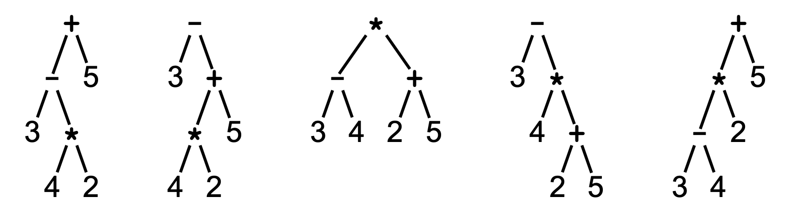
]

---

# Gramàtiques ambigües

La prioritat i associativitat permeten eliminar ambigüitats.

- Prioritat: `1 * 2 + 3 * 4`

.cols5050[
.col1[.center[
`*` té més prioritat que `+`

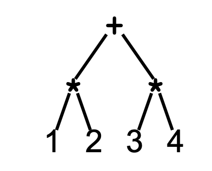
]]
.col2[.center[
`+` té més prioritat que `*`

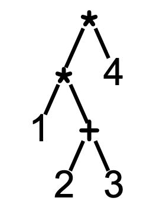
]
]]

- Associativitat: `1 - 2 - 3 - 4`

.cols5050[
.col1[.center[
associativitat per l'esquerra

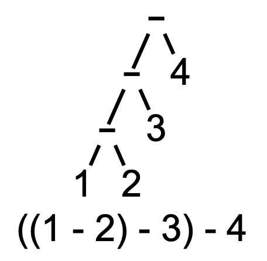
]]
.col2[.center[
associativitat per la dreta

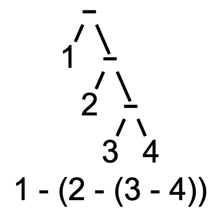
]
]]

---

# Desambiguació clàssica

Comencem amb:

```
expr → expr + expr
     | expr - expr
     | expr * expr
     | expr / expr
     | NUM
```

> ➡️ És ambigua: no hi ha la prioritat ni associativitat.


---

# Desambiguació clàssica

Podem assignar prioritats trencant en vàries regles, una per nivell:

```
expr → expr + expr
     | expr - expr
     | expr * expr
     | expr / expr
     | NUM
```

> ⬇

```
expr → expr + expr
     | expr - expr
     | term

term → term * term
     | term / term
     | NUM
```


> ➡️ Encara és ambigua: falta associativitat.


---

# Desambiguació clàssica

Podem fer que un costat o altre afecti el següent nivell de prioritat:

```
expr → expr + expr
     | expr - expr
     | term

term → term * term
     | term / term
     | NUM
```

> ⬇

```
expr → expr + term
     | expr - term
     | term

term → term * NUM
     | term / NUM
     | NUM
```


> ✅ La gramàtica ja no és ambigua.

> ❌ Però el `-` queda associat per la dreta...

---

# Desambiguació amb ANTLR

- La prioritat de les regles ve donada per l'ordre d'escriptura

- Podem combinar components en la mateixa regla

- L'associaciativitat és per l'esquerra per defecte

- Té una manera de definir l'associativitat per la dreta


**Exemple**:

```antlr4
expr : <assoc=right> expr '^' expr
     | expr ('*' | '/') expr
     | expr ('+' | '-') expr
     | NUM ;
```

---
class: left, middle, inverse

## Contingut

- .brown[Introducció]

- .brown[Visió general]

- .brown[Anàlisi lèxica]

- .cyan[Anàlisi sintàctica]

  - .brown[Desambiguació de gramàtiques]

  - .cyan[Generadors d'analitzadors]

- Arbres de sintaxi abstracta

- Anàlisi semàntica

- Interpretació

---

# Generadors d'analitzadors sintàctics

Existeixen diferents tècniques per generar analitzadors sintàctics, amb propietats
diferents.

- **Analitzadors descendents** (*top-down parsers*): reconeixen l'entrada d'esquerra
a dreta tot buscant derivacions per l'esquerra expandint la gramàtica de l'arrel
cap a les fulles.

- **Analitzadors ascendents** (bottom-up *parsers*): reconeixen primer sobre les
unitats més petites de l'entrada analitzada abans de reconèixer l'estructura
sintàctica segons la gramàtica.


.center[
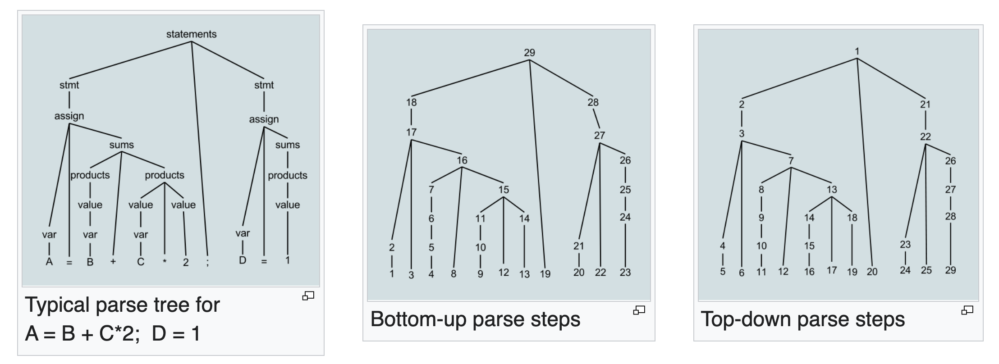
]
.right[.small[
Figura: [Wikipedia](https://en.wikipedia.org/wiki/Bottom-up_parsing)
]]

---

# Generadors d'analitzadors sintàctics

## Analitzadors descendents LL(*k*)

- LL: Left-to-right, Left-most derivation<br>
- *k*: nombre de tokens que mira endavant

**Idea bàsica:** mirar el següent token per poder
decidir quina producció utilitzar.

**Implementació:** Associar una funció a cada construcció del LP.

- Si la construcció està definida per una única regla:

    La seva funció associada cridarà a les funcions associades a les
    construccions que apareixen en aquesta regla i comprovarà que els tokens
    que apareixen en la definició son els que apareixen en la seqüència
    donada.

- Si la construcció està definida per diverses regles:

    La decisió sobre quina regla s’ha d’aplicar es basa
    en mirar els següents *k* tokens.

---

# Generadors d'analitzadors sintàctics

## Analitzadors descendents LL(1)

.cols5050[
.col1[
Exemple de gramàtica:

```antlr
root    : stmt* 'end'
        ;

stmt    : 'if' expr 'then' stmt
        | 'while' expr 'do' stmt
        | expr ':=' expr
        ;

expr    : NUMBER
        | '(' expr ')'
        ;
```

<br>

**Exercici:** <br>Implementeu `expr()` i `root()`.

]
.col2[
Parser LL(1):

```python
def stmt():
    if current_token() == IF:
        match(IF)
        cond = expr()
        match(THEN)
        then = stmt()
        return Node(IF, cond, then)
    elif current_token() == WHILE:
        match(WHILE)
        cond = expr()
        match(DO)
        loop = stmt()
        return Node(WHILE, cond, loop)
    elif current_token() in [NUMBER, LPAREN]:
        lvalue = expr()
        match(ASSIGN)
        rvalue = expr()
        return Node(ASSIGN, lvalue, rvalue)
    else:
        SyntaxError()
```
]
]


---

# Generadors d'analitzadors sintàctics

## Analitzadors descendents LL(1)

Inconvenients principals:

- Les produccions no poden tenir prefixos comuns (no sabria quina triar).

    ```
    expr → ID ( expr )
         | ID = expr
    ```

- Les regles no poden tenir recursivitat per l'esquerra (es penjaria).

    ```
    expr → expr + term
         | term
    ```


---

# Generadors d'analitzadors sintàctics

## Analitzadors descendents LL(1)

Comencem amb:

```
expr  → expr '+' term                   💣 prefixos comuns
      | expr '-' term
      | term
```

> ⬇ factoritzem els prefixos comuns

```
expr  → expr ('+' term | '-' term)      💣 recursivitat per l'esquerra
      | term
```

> ⬇ substituim recursivitat per l'esquerra per recursivitat per la dreta

```
expr  → term expr2
expr2 → '+' term expr2
      | '-' term expr2
      | ε
```

> ✅


---

# ANTLR

- ANTLR és un analitzador descendent LL(*k*).

- Permet explicitar tokens a les regles sintàctiques:

    ```antlr4
    expr : expr '+' expr ;
    ```

- Permet usar `*` i `+` a les regles sintàctiques:

    ```antlr4
    block : statement+ ;
    ```

- Permet definir fàcilment la prioritat d'operadors i associativitat:

    ```antlr4
    expr : <assoc=right> expr '^' expr
         | expr ('*' | '/') expr
         | expr ('+' | '-') expr
         | NUM ;
    ```

---

# Exercicis

.small[
**P1:** Escriviu gramàtiques no ambigües pels llenguatges següents:

1. El conjunt de tots els mots amb `a`s i `b`s que són palíndroms.

1. Mots que tenen el patró `a*b*` amb més  `a`s que `b`s.

1. Textos amb parèntesis i claudàtors ben aniuats.
<br>Exemple: `( [ [ ] ( ( ) [ ( ) ] [ ] ) ] )`.

1. El conjunt de tots els mots amb `a`s i `b`s tals que a cada `a`
li segueix immediatament per, almenys, una `b`.

1. El conjunt de tots els mots amb `a`s i `b`s amb el mateix nombre d'`a`s que `b`s.

1. El conjunt de tots els mots amb `a`s i `b`s amb un nombre diferent d'`a`s que `b`s.

1. Blocs d'instruccions separades per `;` a la Pascal. Exemple:
<br>`BEGIN instrucció ; BEGIN instrucció ; instrucció END ; instrucció END`.

1. Blocs d'instruccions acabades per `;` a la C.
<br>Exemple: `{ instrucció ; { instrucció ; instrucció ; } ; instrucció ; }`.

<br>

**P2:** Especifiqueu les gramàtiques anteriors amb notació ANTLR, modificant la gramàtica si és necessari.
]

---

# Exercicis

.small[
**P3:** Sense utilitzar cap eina ni llibreria (ni `eval`!), escriviu en
Haskell, Python o C++ un analitzador descendent LL(1)
que llegeixi una seqüència d'expressions i escrigui el resultat de cadascuna d'elles.
[TBD: problema pel Jutge! 😄]

- Entrada:

    ```
    2
    2 * 3
    2 * 3 + 1
    2 * (3 + 1)
    10 - 3 - 2
    13 / 3
    ```

- Sortida:

    ```
    2
    6
    7
    8
    5
    4
    ```
]

---

# Exercicis

.small[
**P4:** Sense utilitzar cap eina ni llibreria, escriviu en
Haskell, Python o C++ un analitzador descendent LL(1)
que llegeixi una seqüència d'expressions i construeixi i escrigui l'arbre de sintaxi abstracta de cadascuna.
[TBD: problema pel Jutge! 😄]

- Entrada:

    ```
    2 * (3 + 1)
    (10 - 3 - 2) / 4
    ```

- Sortida:

    ```
    (MUL 2 (SUM 3 1))
    (DIV (SUB (SUB 10 3) 2) 4)
    ```
]

---
class: left, middle, inverse

## Contingut

- .brown[Introducció]

- .brown[Visió general]

- .brown[Anàlisi lèxica]

- .brown[Anàlisi sintàctica]

- .cyan[Arbres de sintaxi abstracta]

- Anàlisi semàntica

- Interpretació

---

# Accions

- Amb un analitzador descendent, es poden executar accions
durant el reconeixement de les regles.

    Les accions poden aparèixer en qualsevol punt de la regla:

    ```antlr4
    regla   :       { /* abans */   }
                regla1
                    { /* durant */  }
                regla2
                    { /* durant */  }
                regla3
                    { /* després */ }
            ;
    ```

    → La gramàtica esdevé "imperativa".<br>
    → Les accions s'entrellacen amb la gramàtica.<br>
    → És fàcil entendre què passa i quan passa.


- Amb un analitzador ascendent, només es poden executar accions
després de reconèixer una regla.


---

# Arbres de sintaxi

Usualment, les accions construeixen un arbre de sintaxi concreta
que segueix les regles de la gramàtica.

Aquest arbre es sol convertir en un arbre de sintaxi abstracta.

.center[
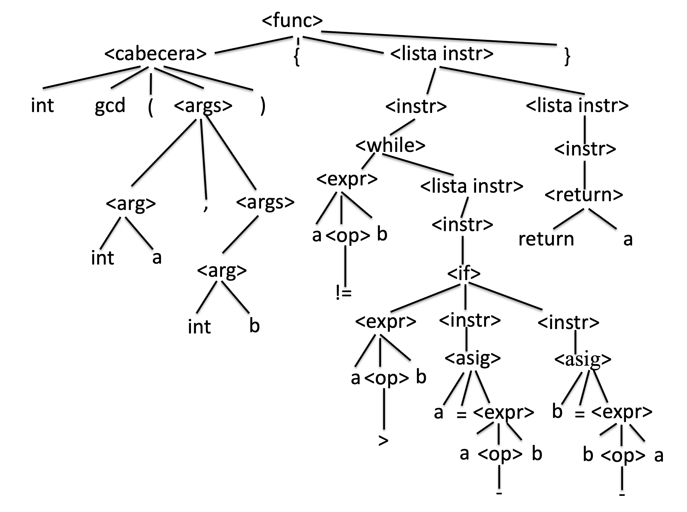
&nbsp;
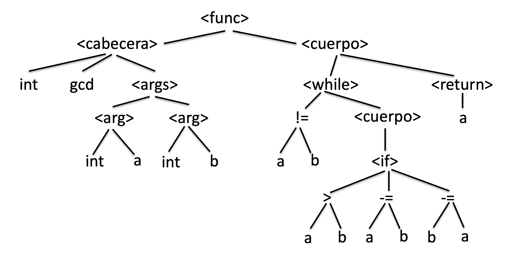
]


→ Es separa l'anàlisi de la traducció.<br>
→ Es facilita les modificacions tot minimitzant les interaccions.<br>
→ Es permet que diferents parts del programa s'analitzin en ordres diferents.

---

# Arbres de sintaxi concreta *vs* abstracta

**Arbre de sintaxi concreta / de derivació:** Reflecteix exactament les regles sintàctiques.

**Arbre de sintaxi abstracta** (*abstract syntax tree*, AST): Representa el programa fidelment, però elimina
i simplifica detalls sintàctics irrellevants.

.cols5050[
.col1[
**Exemple:** Eliminar regles per desambiguar gramàtica.
```antrl
expr    : mexpr ('+' mexpr) * ;
mexpr   : atom  ('*' atom ) * ;
atom    : NUM ;
```

.center[
`3 + 5 * 4`

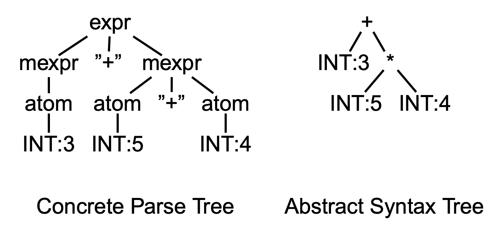
]
]
.col2[
**Exemple:** Aplanar una llista de paràmetres.


```c
int gcd(int a, int b, int c)
```

.center[
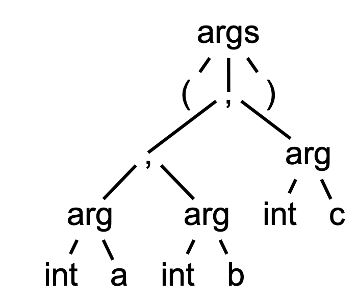
&nbsp;
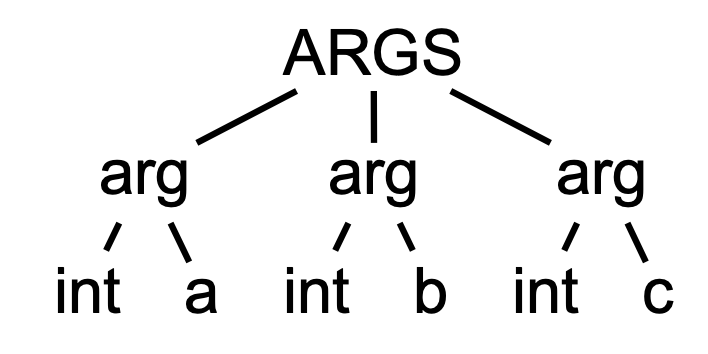
]
]
]

---

# Ús dels ASTs

Un cop construït l'AST, les etapes següents el recorren per a dur a terme les seves tasques:

- L'anàlisi semàntica verificarà l'ús correcte dels elements del programa.

- El generador de codi visitarà l'arbre i li aplicarà regles per generar codi intermedi.

- L'intèrpret es passejarà per l'arbre per dur a termes les seves instruccions.

---

# ASTs en ANTLR

A partir de la gramàtica, ANTLR pot generar un analitzador descendent
amb accions que construeixin un AST.

L'AST es pot visitar a través de *visitors* (un patró de disseny).

ANTLR també genera la interfície dels visitadors, tot generant un esquelet
de mètodes que podem heretar.

Cada mètode s'aplica sobre un tipus de node que correspon a cada regla
de la gramàtica.

---
class: left, middle, inverse

## Contingut

- .brown[Introducció]

- .brown[Visió general]

- .brown[Anàlisi lèxica]

- .brown[Anàlisi sintàctica]

- .brown[Arbres de sintaxi abstracta]

- .cyan[Anàlisi semàntica]

- Interpretació

---


# Anàlisi semàntica

L'analitzador semàntic recorre l'AST, per obtenir tota la informació necessària
per poder generar codi.

Objectius:

- Comprovar la correcció semàntica del programa (comprovació de tipus).

- Resoldre ambigüitats.

- Assignar memòria.

- Construir la taula de símbols.

<br><br>

⛔️ En aquest curs no entrem en aquest vast tema, que deixem per
l'assignatura de Compiladors (recomanada!).
Però al tema "Inferència de tipus" veure com fer comprovació de tipus.

---
class: left, middle, inverse

## Contingut

- .brown[Introducció]

- .brown[Visió general]

- .brown[Anàlisi lèxica]

- .brown[Anàlisi sintàctica]

- .brown[Arbres de sintaxi abstracta]

- .brown[Anàlisi semàntica]

- .cyan[Interpretació]

---

# Interpretació

.center[

]

**Tutorial:** Escriure (en Haskell) un intèrpret per a l'AST d'un senzill llenguatge
de programació (SimpleLP™).

---

# SimpleLP

**Definició del llenguatge**

- Tipus de dades: enters.
- Variables: sempre visibles, inicialitzades a 0.
- Operadors aritmètics: `+` i `-`.
- Operadors relacionals: `≠` i `<` (retornen 0 o 1).
- Instruccions: assignació, composició seqüèncial,
  condicional i iteració.

**Exemple**

```
# Algorisme d'Euclides per calcular el mcd de 105 i 252.
a ← 105
b ← 252
while a ≠ b do
    if a < b then
        b ← b - a
    else
        a ← a - b
    end
end
```

---

# SimpleLP

**Tipus de dades per l'AST**

```haskell
data Expr
    = Val Int                   -- valor
    | Var String                -- variable
    | Add Expr Expr             -- suma (+)
    | Sub Expr Expr             -- resta (-)
    | Neq Expr Expr             -- diferent-de (≠)
    | Lth Expr Expr             -- menor-que (<)

data Instr
    = Ass String Expr           -- assignació
    | Seq [Instr]               -- composició seqüencial
    | Cond Expr Instr Instr     -- condicional
    | Loop Expr Instr           -- iteració
```


---

# SimpleLP

**Tipus de dades per l'AST**

Exemple: AST pel programa anterior:

```haskell
Seq [
    (Ass "a" (Val 105))
    ,
    (Ass "b" (Val 252))
    ,
    (While
        (Neq (Var "a") (Var "b"))
        (Cond
            (Lth (Var "a") (Var "b"))
            (Ass "b" (Sub (Var "b") (Var "a")))
            (Ass "a" (Sub (Var "a") (Var "b")))
        )
    )
]
```

---

# SimpleLP

**Memòria**

Descrivim el valor de les variables a través d'una memòria
de tipus `Mem` amb aquestes operacions:

```haskell
-- retorna una memòria buida
empty :: Mem

-- insereix (o canvia si ja hi era) una clau amb el seu valor
update :: Mem -> String -> Int -> Mem

-- consulta el valor d'una clau en una memòria
search :: Mem -> String -> Maybe Int

-- retorna la llista de claus en una memòria
keys :: Mem -> [String]
```

La implementació seria amb qualsevol diccionari (BST, AVL, hashing, ...).
<br>
[Si voleu provar-ho, useu `Map` de `Data.Map`.]

---

# SimpleLP

**Avaluació de les expressions**

```haskell
--- avalua una expressió en un estat de la memòria
eval :: Expr -> Mem -> Int

eval (Val x) m = x
eval (Var v) m =
    case search v m of
        Nothing -> 0
        Just x  -> x
eval (Add e1 e2) m = eval' e1 e2 m (+)
eval (Sub e1 e2) m = eval' e1 e2 m (-)
eval (Neq e1 e2) m = b2i $ eval' e1 e2 m (/=)
eval (Lth e1 e2) m = b2i $ eval' e1 e2 m (<)

eval' e1 e2 m op = op (eval e1 m) (eval e2 m)

b2i False = 0
b2i True  = 1
```

---

# SimpleLP

**Interpretació de les instruccions**

```haskell
--- retorna l'estat final de la memòria després d'executar una instrucció
--- partint d'un estat inicial de la memòria
exec :: Instr -> Mem -> Mem

exec (Ass v e) m = update v (eval e m) m
exec (Seq []) m = m
exec (Seq (i:is)) m = exec (Seq is) (exec i m)
exec (Cond b i1 i2) m = exec (if eval b m /= 0 then i1 else i2) m
exec (Loop b i) m =
    if eval b m /= 0
        then exec (Loop b i) (exec i m)
        else m
```

---

# SimpleLP

**Execució del programa**

Escriu el valor final de cada variable (en ordre lexicogràfic) després
d'executar una instrucció partint d'una memòria buida.

```haskell
run :: Instr -> IO ()

run i = mapM_ printEntry $ sort $ keys m
    where
        m = exec i empty
        printEntry k = do
            putStr k
            putStr " : "
            print $ fromJust $ search k m
```

Execució amb el programa anterior:

```
a : 21
b : 21
```

---

# Exercicis

1. Modifiqueu l'AST i `eval` per tenir operadors de resta i producte.

1. Modifiqueu l'AST, `exec` i `run` per tal d'afegir  a
SimpleLP una nova instrucció `print`  que escrigui el contingut d'una
expressió. Ara `run` només ha d'executar el programa donat partint d'una
memòria buida.

2. Afegiu una expressió `read` a SimpleLP que retorni el valor del següent
enter de l'entrada.

3. Afegiu una instrucció del tipus `for i ← a .. b`.

4. Feu que `print` pugui escriure una llista de valors (`print a, b, a + b` per ex).

5. Escriviu l'AST d'aquest programa:

    ```
    # factorial en SimpleLP
    n ← read
    f ← 1
    for i ← 2 .. n
        f ← f * i
    end
    print n, f
    ```

